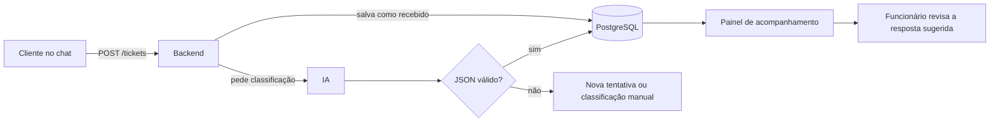

# Central de Atendimento com IA
 
Sistema de atendimento em que o cliente descreve o problema num chat, o backend usa uma IA para
**classificar** a mensagem (categoria, prioridade e assunto), encaminha ao departamento certo e
**sugere uma resposta** para o funcionário revisar antes de enviar. Tudo fica registrado num banco de
dados e é exibido num painel de acompanhamento.
 
O foco do projeto não é só chamar uma IA, e sim **tratar bem o que acontece ao redor dela**:
 
- como **validar** a resposta da IA antes de confiar nela;
- o que fazer quando a resposta vem **inválida** (JSON quebrado, campo faltando, categoria inventada);
- como o sistema se comporta quando a **API da IA fica indisponível**.
## Fluxo
 

 
O ticket é gravado **antes** de qualquer chamada à IA, então o cliente nunca perde a mensagem,
mesmo que a IA esteja fora do ar. A parte da IA (caixas "IA" e "JSON válido?") entra nas etapas 5 a 8.
 
## Status do projeto
 
- [x] 1. Estrutura do repositório (frontend e backend)
- [x] 2. Backend base: Node.js, TypeScript e Express (criar e listar tickets)
- [x] 3. Banco PostgreSQL, migrações e contrato Zod da resposta da IA
- [ ] 4. Frontend ligado à API (em andamento)
- [ ] 5. Serviço de IA com provedor simulado (que pode falhar de propósito)
- [ ] 6. Validação da resposta e tratamento de resposta inválida
- [ ] 7. API da IA indisponível: timeout, retentativas, circuit breaker e fila
- [ ] 8. IA real gratuita (Gemini) usando a mesma interface
- [ ] 9. Revisão humana: aprovar, editar ou descartar a resposta sugerida
- [ ] 10. Testes dos cenários de falha, documentação e deploy da demonstração
## Tecnologias
 
| Camada | Tecnologia |
|---|---|
| Frontend | HTML, CSS e JavaScript puro |
| Backend | Node.js, TypeScript, Express 5 |
| Validação | Zod |
| Banco de dados | PostgreSQL (Neon na nuvem ou Docker local) |
| Testes | Vitest e Supertest |
| IA | provedor simulado primeiro; depois uma IA gratuita (Gemini) |
 
## Estrutura do repositório
 
```
├── frontend/
│   ├── index.html          chat do cliente
│   ├── painel.html         painel de acompanhamento
│   ├── css/style.css
│   └── js/                 dados.js, chat.js, painel.js
├── backend/
│   ├── src/
│   │   ├── ai/             contrato Zod da resposta da IA
│   │   ├── db/             conexão, migrações e repositório PostgreSQL
│   │   ├── tickets/        tipos, validação, rotas e repositório em memória
│   │   ├── app.ts, config.ts, server.ts, error-handler.ts
│   ├── package.json, tsconfig.json, .env.example
│   └── README.md           detalhes da API
├── docker-compose.yml      PostgreSQL local (opcional)
└── README.md
```
 
## Como rodar
 
**Requisitos:** Node.js 20 ou superior e um PostgreSQL (Docker ou um banco gratuito no Neon).
 
```bash
# 1. Banco local com Docker (pule se for usar o Neon)
docker compose up -d
 
# 2. Backend
cd backend
npm install
cp .env.example .env        # Windows (PowerShell): Copy-Item .env.example .env
# edite o .env e confira o DATABASE_URL
npm run db:migrate          # cria as tabelas
npm run dev                 # API em http://localhost:3000
```
 
3. **Frontend:** abra a pasta `frontend/` no VS Code e inicie o `index.html` com a extensão
   Live Server (porta 5500). O painel fica em `painel.html`. Se usar outra porta, ajuste
   `CORS_ORIGIN` no `.env` do backend.
Para rodar os testes: `cd backend && npm test`. Os testes do banco só rodam se houver `DATABASE_URL`,
e usam um schema temporário, sem mexer nos seus dados.
 
## Contrato de dados
 
A IA deve devolver exatamente este formato (validado com Zod; qualquer coisa diferente é tratada
como resposta inválida):
 
```json
{
  "categoria": "financeiro",
  "prioridade": "alta",
  "assunto": "Cobrança duplicada no cartão",
  "respostaSugerida": "Olá! Vamos verificar a cobrança e retornamos em até 1 dia útil."
}
```
 
| Campo | Valores permitidos |
|---|---|
| categoria | `financeiro`, `suporte_tecnico`, `comercial`, `entrega`, `outros` |
| prioridade | `urgente`, `alta`, `media`, `baixa` |
| status do ticket | `recebido`, `aguardando_ia`, `aguardando_revisao`, `classificacao_manual`, `respondido` |
 
## Falhas e comportamento do sistema
 
| Situação | Comportamento | Situação atual |
|---|---|---|
| Mensagem vazia ou acima de 2000 caracteres | responde 400 com a lista de campos inválidos | implementado |
| JSON quebrado na requisição | responde 400 `json_invalido` | implementado |
| Banco de dados fora do ar | responde 503 `banco_indisponivel`, sem expor detalhes internos | implementado |
| Resposta da IA inválida | nova tentativa informando o erro; se persistir, ticket vai para `classificacao_manual` com a resposta bruta guardada | etapa 6 |
| API da IA indisponível | timeout, retentativas com espera crescente, circuit breaker e fila de tickets `aguardando_ia` | etapa 7 |
 
## Segurança
 
- O arquivo `.env` não é versionado. Chaves de API e senhas ficam só nele, no backend.
- A chave da IA nunca vai para o frontend nem para o repositório.
- Os dados de demonstração são fictícios.
## Autor
 
Desenvolvido por Ruan Reymond ([@RuanReymond](https://github.com/RuanReymond)).
 